# Todo Application - CONTAINERIZED | HELM | CI/CD | KUBERNETES | TRIVY 

A three-tier Todo application implemented with a practical DevOps delivery workflow: Docker multi-stage builds, Docker Compose, Trivy image scanning, Kubernetes on Minikube, and Helm release management.

This README distinguishes the **local Minikube assessment deployment** from the repository's existing **self-hosted Docker Compose deployment workflow**. It does not claim that this assessment run was deployed to Amazon EKS.

## Architecture

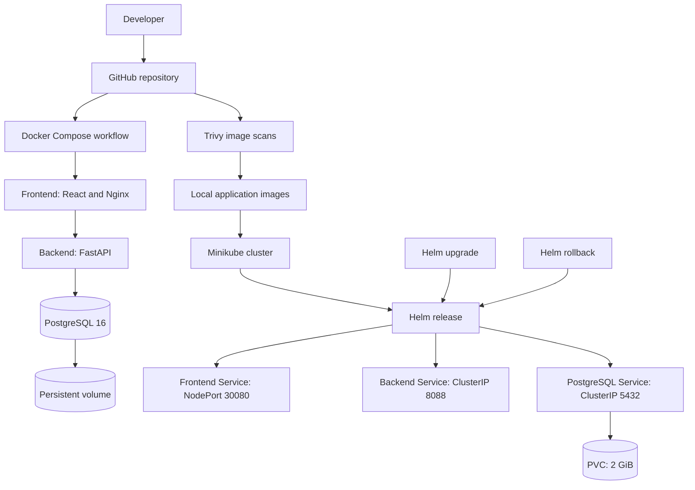

### Application tiers

| Tier | Technology | Responsibility | Kubernetes access |
|---|---|---|---|
| Frontend | React, Nginx | Serves the UI and makes API requests | NodePort 30080 |
| Backend | Python, FastAPI, Uvicorn | Handles Todo API requests and database operations | ClusterIP 8088 |
| Database | PostgreSQL 16 Alpine | Stores Todo records | ClusterIP 5432 |

The backend connects to PostgreSQL through the Kubernetes Service DNS name `db`. The PostgreSQL data directory is backed by a PersistentVolumeClaim (PVC) in Kubernetes and a named volume in Docker Compose.

## Technology stack

- **Application:** React, FastAPI, Python, PostgreSQL 16
- **Containers:** Docker, multi-stage Dockerfiles, Docker Compose
- **Security scanning:** Trivy
- **Orchestration:** Kubernetes, Minikube
- **Release management:** Helm
- **CI/CD deployment workflow:** GitHub Actions with self-hosted runners
- **OS used for the practical deployment:** Ubuntu Linux

## Repository structure

```text
todo-app/
├── .github/
│   └── workflows/
│       └── deploy.yml
├── backend/
│   ├── Dockerfile
│   ├── main.py
│   └── requirements.txt
├── frontend/
│   ├── Dockerfile
│   ├── nginx.conf
│   └── src/
├── k8s/
│   └── todo-app.yaml
├── todo-app/                 # Helm chart
│   ├── Chart.yaml
│   ├── values.yaml
│   └── templates/
│       └── todo.yaml
├── docs/
│   └── todo_app_containerized_microservices_deployment_report.pdf
├── .env.example
├── .gitignore
├── docker-compose.yml
└── README.md
```

## 1. Prerequisites

Install or have available:

- Docker Engine and Docker Compose plugin
- Git
- kubectl
- Minikube
- Helm
- Trivy (for image scanning)

Clone the repository:

```bash
git clone https://github.com/reddynaveen0106/todo-app.git
cd todo-app
```

## 2. Configure environment variables

Create a local environment file:

```bash
cp .env.example .env
```

Edit `.env` and set a strong, unique database password. The environment file is ignored by Git; **never commit credentials**.

The Compose configuration reads:

- `POSTGRES_USER`
- `POSTGRES_PASSWORD`
- `POSTGRES_DB`
- `FRONTEND_PORT`
- `BACKEND_PORT`

## 3. Build and run with Docker Compose

Build the frontend and backend images and start the three services:

```bash
docker compose build
docker compose up -d
docker compose ps
```

The Compose project contains:

- `frontend` — Nginx serves the built frontend on container port 80.
- `backend` — FastAPI listens on container port 8088.
- `db` — PostgreSQL 16 Alpine with a named data volume and a `pg_isready` health check.

Check the backend endpoints (with the example host port mapping):

```bash
curl http://localhost:8088/health
curl http://localhost:8088/todos
```

The health endpoint returns:

```json
{"status":"ok"}
```

View logs and stop the stack:

```bash
docker compose logs --tail=100
docker compose down
```

The named PostgreSQL volume is retained by `docker compose down`. Avoid `docker compose down -v` unless intentionally deleting the database volume.

## 4. Trivy image security scanning

Scan each image:

```bash
trivy image todo-app-backend:latest
trivy image todo-app-frontend:latest
trivy image postgres:16-alpine
```

Save scan reports:

```bash
trivy image --format table --output backend-scan.txt todo-app-backend:latest
trivy image --format table --output frontend-scan.txt todo-app-frontend:latest
trivy image --format table --output postgres-scan.txt postgres:16-alpine
```

### Findings recorded during the practical run

| Scan target | Findings |
|---|---|
| Backend image | 254 total: 8 UNKNOWN, 71 LOW, 120 MEDIUM, 55 HIGH, 0 CRITICAL |
| Frontend image | 73 total: 44 LOW, 11 MEDIUM, 17 HIGH, 1 CRITICAL |
| PostgreSQL Alpine OS packages | 29 total: 7 MEDIUM, 22 HIGH, 0 CRITICAL |
| PostgreSQL `gosu` binary | 62 total: 2 UNKNOWN, 3 LOW, 31 MEDIUM, 25 HIGH, 1 CRITICAL |

The PostgreSQL OS and `gosu` binary results are separate Trivy targets. Findings are recorded for follow-up; they have not been represented as remediated. Before a production release, review the critical/high findings, update affected packages or base images, rebuild, and rescan.

## 5. Kubernetes deployment with Minikube

Start and verify Minikube:

```bash
minikube start
minikube status
kubectl get nodes -o wide
```

Load locally built images into Minikube:

```bash
minikube image load todo-app-backend:latest
minikube image load todo-app-frontend:latest
minikube image load postgres:16-alpine
```

### Create the database Secret

The manifest and Helm chart reference a Secret named `todo-db-secret`. Create it from the local `.env` file without printing its values:

```bash
set -a
source .env
set +a

kubectl create secret generic todo-db-secret \
  --from-literal=POSTGRES_USER="$POSTGRES_USER" \
  --from-literal=POSTGRES_PASSWORD="$POSTGRES_PASSWORD" \
  --from-literal=POSTGRES_DB="$POSTGRES_DB" \
  --dry-run=client -o yaml | kubectl apply -f -
```

### Apply raw Kubernetes manifests (alternative to Helm)

The standalone manifest is available at `k8s/todo-app.yaml`:

```bash
kubectl apply -f k8s/todo-app.yaml
kubectl get deployments
kubectl get pods -o wide
kubectl get services
kubectl get pvc
```

It defines three Deployments and Services, a ConfigMap, a 2 GiB PVC, health probes and CPU/memory requests and limits.

> Use either the raw manifest workflow or the Helm release workflow as the owner of these resources. Do not repeatedly apply the standalone manifest over Helm-managed resources; that can create ownership conflicts or configuration drift.

## 6. Helm chart deployment

The chart is located in `todo-app/`.

Validate and render the chart:

```bash
cd todo-app
helm lint .
helm template todo-app .
```

Install the release:

```bash
helm install todo-app .
helm list
helm status todo-app
```

Upgrade the application to two frontend/backend replicas:

```bash
helm upgrade todo-app . --set replicaCount=2
helm history todo-app
kubectl get deployments
```

Roll back to revision 2:

```bash
helm rollback todo-app 2
helm history todo-app
kubectl rollout status deployment/backend
kubectl rollout status deployment/frontend
kubectl get deployments
kubectl get pods
kubectl get pvc
```

Helm preserves revision history and creates a new revision for each rollback; a rollback does not delete earlier revisions.

## 7. Access and test the Kubernetes services

Get the frontend URL:

```bash
minikube service frontend --url
```

The practical run exposed the frontend through NodePort 30080.

Forward the backend Service to a free local port. If port 8088 is already occupied by Docker Compose, use 8090:

```bash
kubectl port-forward svc/backend 8090:8088
```

In a second terminal:

```bash
curl http://localhost:8090/health
curl http://localhost:8090/todos
```

Expected health response:

```json
{"status":"ok"}
```

The backend logs should show database initialization and successful `GET /health` responses.

## 8. Existing GitHub Actions deployment workflow

The repository includes `.github/workflows/deploy.yml`. It is configured to run on pushes to the `development` and `production` branches and uses a self-hosted runner to execute Docker Compose deployments with separate Compose project names and GitHub Environment variables/secrets.

This workflow is a Docker Compose deployment workflow. The Minikube/Helm assessment steps documented above were performed separately in the local Ubuntu environment; they should not be confused with an automated EKS deployment.

## 9. Operational and security considerations

- Keep `.env` and secret values out of version control.
- Use strong, unique credentials and rotate credentials used for local testing.
- Pin production images to controlled versions or immutable digests.
- Remediate critical/high Trivy findings and rescan before production deployment.
- Back up PostgreSQL and periodically test restore procedures.
- Review resource requests/limits against measured usage.
- For a production Kubernetes environment, add appropriate ingress/TLS, access controls, monitoring, centralized logging, and backup/restore automation.

## Deployment evidence screenshots

The screenshots below record the practical deployment, Helm release management and Trivy image scans. The image files are stored in `docs/screenshots/`.

### Kubernetes and Helm verification

**1. Helm rollback and Kubernetes workload state**

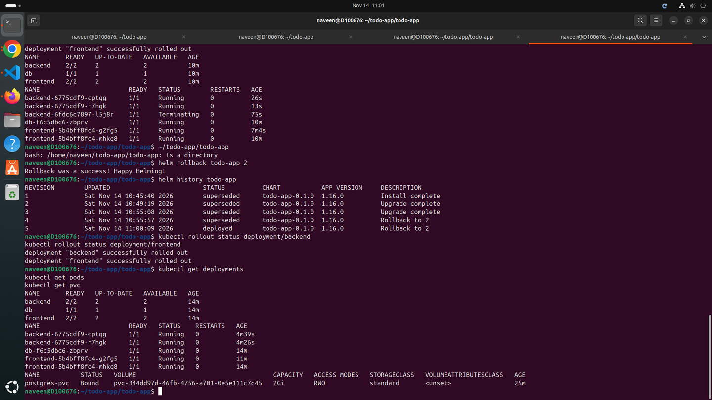

**2. Rollback history and deployment rollout**

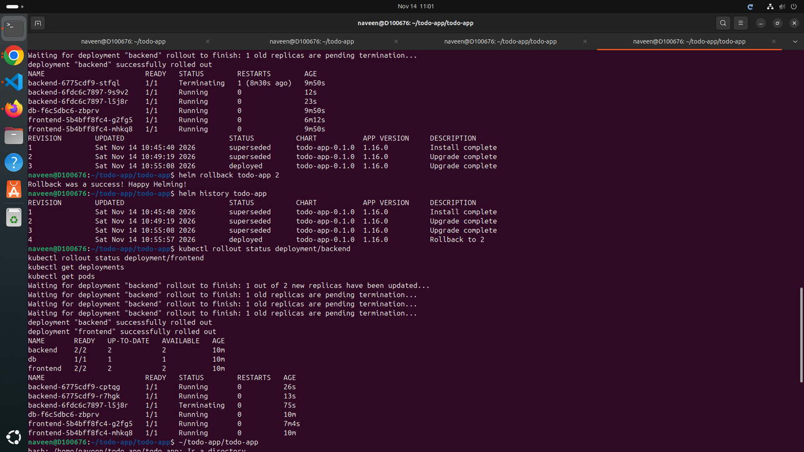

**3. Backend health checks and frontend service access**

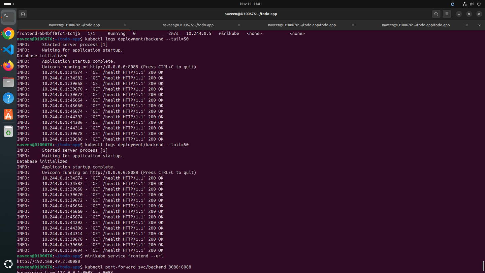

**4. Helm rollback terminal history**

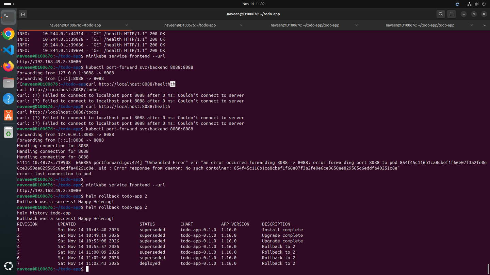

### Trivy security scan evidence

**5. PostgreSQL image scan**

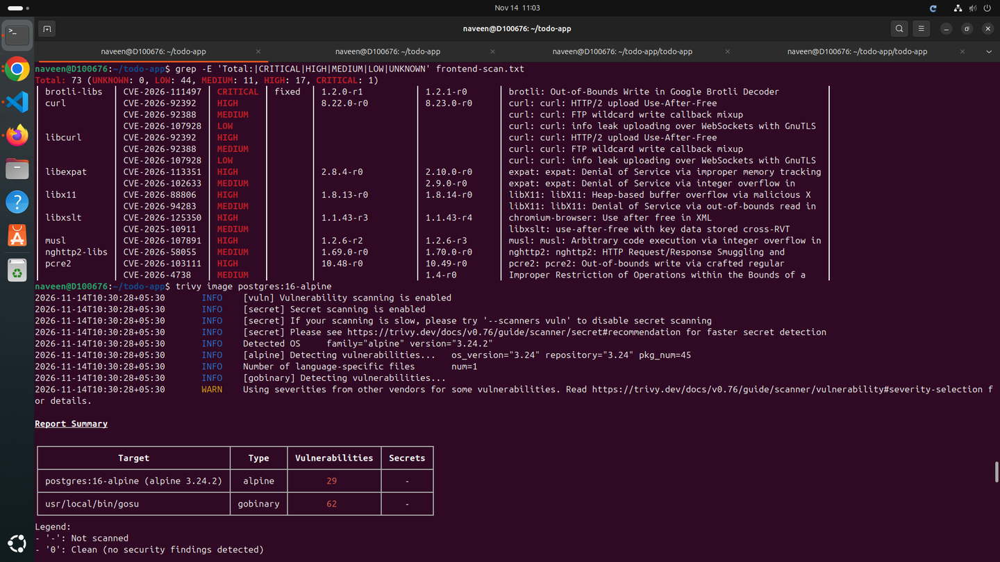

**6. Frontend image scan**

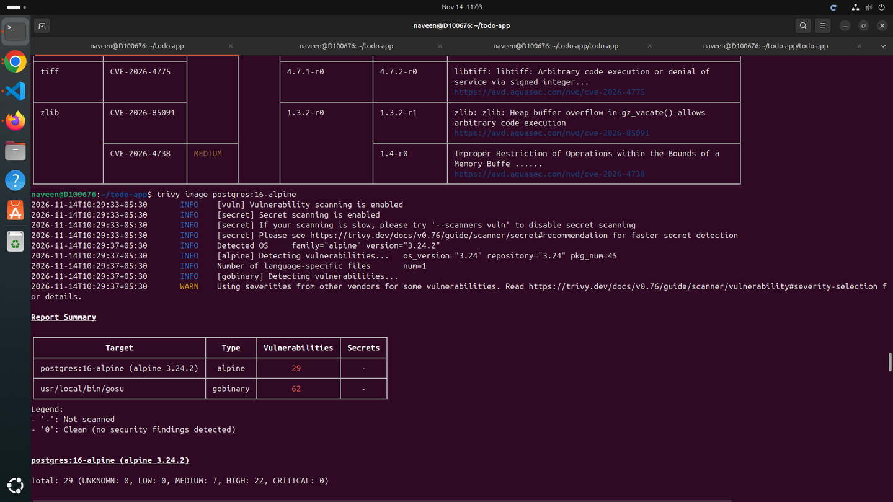

**7. Backend image scan**

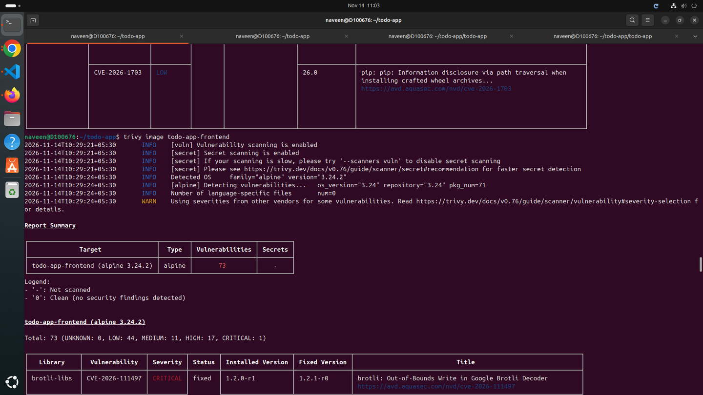

**8. Docker Compose build and startup**

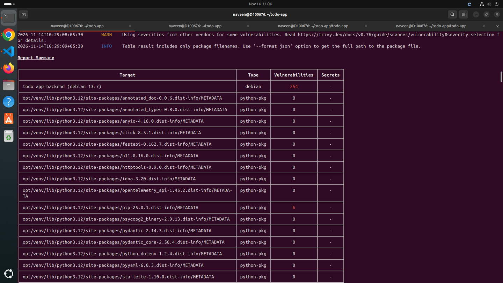

**9. Additional Trivy vulnerability details**

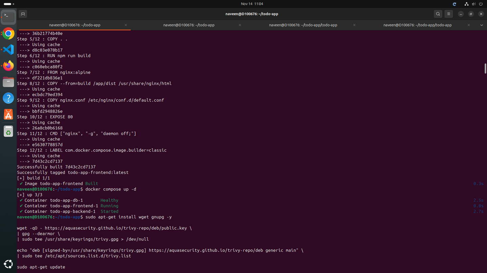

### Source configuration snapshots

These visual snapshots highlight the actual repository configuration files used in the practical deployment. The complete, editable YAML and Dockerfiles remain available in their source directories.

**10. Docker Compose and multi-stage Dockerfiles**

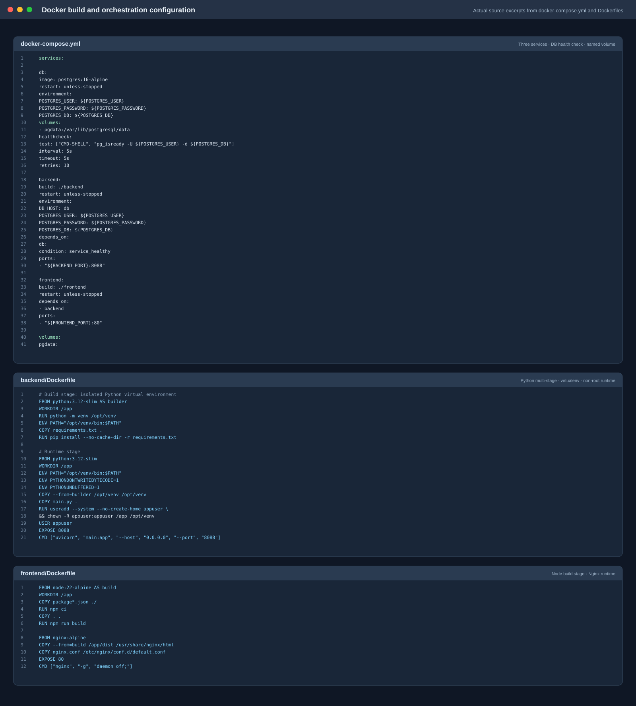

**11. Kubernetes manifest — Deployments, Services, Secret references, PVC, probes and resource limits**

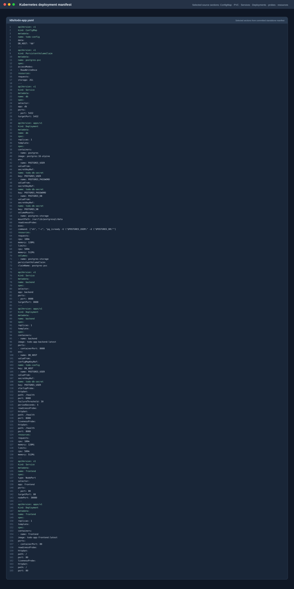

**12. Helm chart configuration and GitHub Actions deployment workflow**

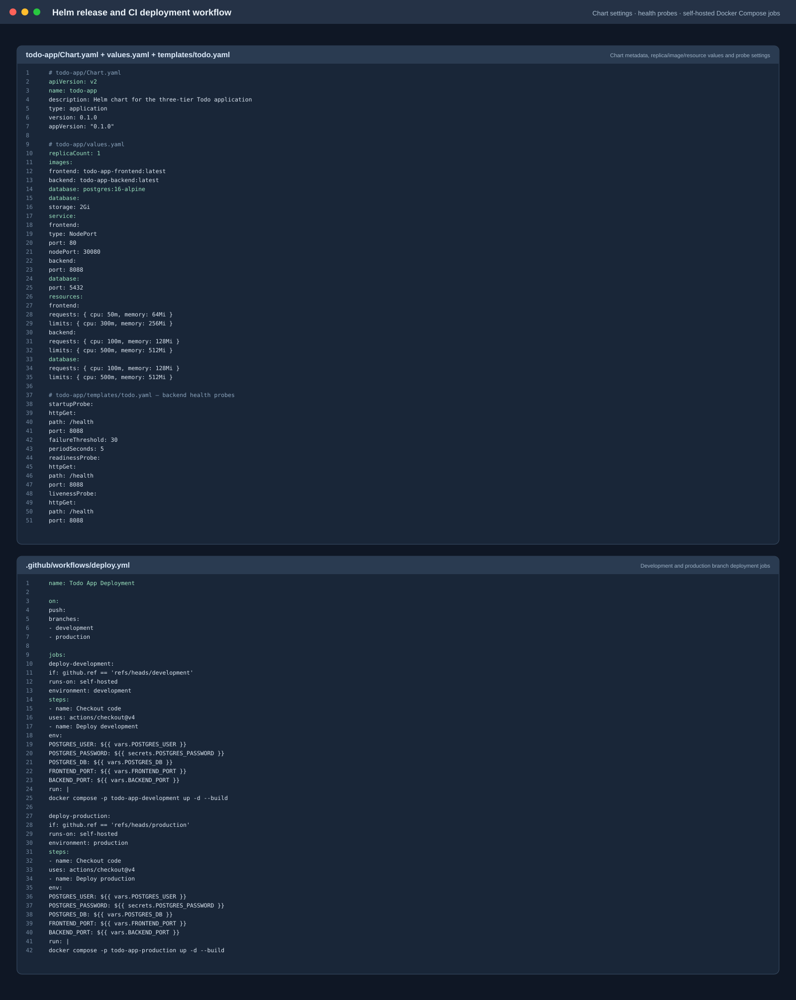

## Assessment report

The practical assessment report, architecture flowchart, scan summaries and terminal evidence are provided in:

`docs/todo_app_containerized_microservices_deployment_report.pdf`

## Author

**Naveen Reddy**  
GitHub: https://github.com/reddynaveen0106

Repository: https://github.com/reddynaveen0106/todo-app
