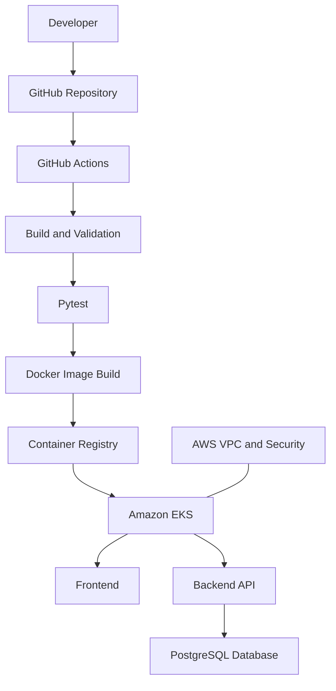

# Todo Application – Cloud-Native DevOps Deployment

A full-stack Todo application deployed using modern DevOps practices, containerization, CI/CD automation and AWS cloud infrastructure.

The project demonstrates an end-to-end deployment workflow, from source code management and automated testing to container orchestration using Amazon Elastic Kubernetes Service (EKS).

## Project Overview

This project consists of a frontend, backend API and PostgreSQL database. The application is containerized using Docker, supports local deployment through Docker Compose and is deployed to AWS using Kubernetes on Amazon EKS.

GitHub Actions automates the CI/CD workflow, including application validation and automated Python testing.

## Architecture



*Note: Adapt the container registry and database connectivity in this diagram to match your actual production configuration.*

## Technology Stack

| Category | Technologies |
|---|---|
| Cloud Platform | AWS |
| Networking | AWS VPC, Subnets, Security Groups |
| Containerization | Docker, Docker Compose |
| Container Orchestration | Kubernetes, Amazon EKS |
| CI/CD | GitHub Actions |
| Backend | Python |
| Testing | Pytest |
| Database | PostgreSQL 16 |
| Version Control | Git, GitHub |
| Operating System | Linux |

## Repository Structure

```text
todo-app/
│
├── .github/
│   └── workflows/
│       └── CI/CD workflow files
│
├── backend/
│   └── Backend application and tests
│
├── frontend/
│   └── Frontend application
│
├── .env.example
├── .gitignore
├── docker-compose.yml
└── README.md
```

Kubernetes deployment manifests are maintained separately if applicable to your repository. Add their actual directory and filenames here.

## Application Architecture

### 1. Frontend

- Provides the user interface for managing Todo items.
- Communicates with the backend API.
- Containerized using Docker.
- Served through the frontend container.

### 2. Backend

- Handles application business logic and API requests.
- Communicates with PostgreSQL.
- Uses environment variables for database configuration.
- Includes automated Python tests using Pytest.

### 3. Database

- PostgreSQL 16 Alpine image.
- Persistent storage using Docker volumes.
- Database health checks using `pg_isready`.
- Backend startup depends on database health.

## Docker Compose Deployment

Docker Compose manages the application services:

- Frontend
- Backend
- PostgreSQL

### Prerequisites

- Docker
- Docker Compose plugin
- Git

### Setup

Clone the repository:

```bash
git clone https://github.com/reddynaveen0106/todo-app.git

cd todo-app
```

Create the environment file:

```bash
cp .env.example .env
```

Update the environment variables:

```env
POSTGRES_USER=todo_user
POSTGRES_PASSWORD=change_this_password
POSTGRES_DB=tododb

FRONTEND_PORT=8081
BACKEND_PORT=8088
```

Use your actual `.env.example` variables and configure secure credentials.

Start the application:

```bash
docker compose up -d --build
```

Check running containers:

```bash
docker compose ps
```

View application logs:

```bash
docker compose logs -f
```

Stop the application:

```bash
docker compose down
```

## Automated Testing – Pytest

Pytest is used to execute automated backend tests and validate application functionality.

Run the tests from the backend directory:

```bash
cd backend

pytest
```

For detailed test output:

```bash
pytest -v
```

Test execution is integrated into the CI workflow to help identify application issues before deployment.

## CI/CD – GitHub Actions

GitHub Actions automates the application delivery workflow.

### CI/CD workflow

1. Developer pushes code to GitHub.
2. GitHub Actions triggers the configured workflow.
3. Application dependencies are installed.
4. Automated tests are executed using Pytest.
5. Docker images are built.
6. Container images are prepared for deployment.
7. Deployment workflows publish and deploy the application to the target environment.

*The exact execution order and deployment triggers depend on the configured workflow files.*

## AWS Infrastructure and Deployment

The application is deployed using AWS cloud infrastructure.

### AWS Services

| AWS Service | Purpose |
|---|---|
| VPC | Network isolation |
| Subnets | Network segmentation |
| Security Groups | Control inbound and outbound traffic |
| EKS | Managed Kubernetes control plane |
| EC2 Worker Nodes | Run Kubernetes workloads |
| IAM | Identity and access management |
| Container Registry | Store application images, if configured |

### AWS VPC and Security Architecture

The AWS networking architecture provides controlled connectivity between application components.

Key considerations:

- Network segmentation using public and private subnets.
- Restrict inbound traffic using security group rules.
- Avoid exposing database services directly to the public internet.
- Apply least-privilege IAM permissions.
- Secure application configuration and database credentials.
- Restrict access to Kubernetes workloads and cluster resources.

### Amazon EKS Deployment

Kubernetes is used to orchestrate the application containers.

Deployment activities include:

- Kubernetes Deployment configurations.
- Kubernetes Services.
- Container image deployment.
- Application replica management.
- Pod health and status monitoring.
- Application rollout and troubleshooting.

Useful Kubernetes commands:

```bash
kubectl get nodes

kubectl get pods -A

kubectl get deployments

kubectl get services

kubectl describe pods

kubectl logs <pod-name>
```

## DevOps Best Practices

The project incorporates the following engineering practices:

- Source code version control using Git.
- Automated CI/CD workflows.
- Automated backend testing.
- Containerized application deployment.
- Environment-based application configuration.
- Persistent database storage.
- Database health checks.
- Kubernetes workload orchestration.
- Network segmentation and security controls.
- Least-privilege access principles.
- Deployment validation and troubleshooting.

## Key Learning Outcomes

Through this project, I gained practical experience in:

- Building and deploying a full-stack application.
- Implementing CI/CD automation with GitHub Actions.
- Containerizing applications using Docker.
- Managing multi-container applications using Docker Compose.
- Running automated backend tests using Pytest.
- Deploying containerized applications to Amazon EKS.
- Designing AWS networking and security architecture.
- Troubleshooting container and Kubernetes deployments.
- Understanding end-to-end DevOps delivery workflows.

## Future Improvements

- Infrastructure provisioning using Terraform.
- Image vulnerability scanning.
- Kubernetes Helm deployments.
- Prometheus and Grafana monitoring.
- Centralized logging using Loki.
- GitOps deployment using Argo CD.
- Deployment automation using Azure DevOps.

## Author

**Naveen Reddy**

Cloud & DevOps Engineering Enthusiast

GitHub: https://github.com/reddynaveen0106

---

**Project Repository:** https://github.com/reddynaveen0106/todo-app
